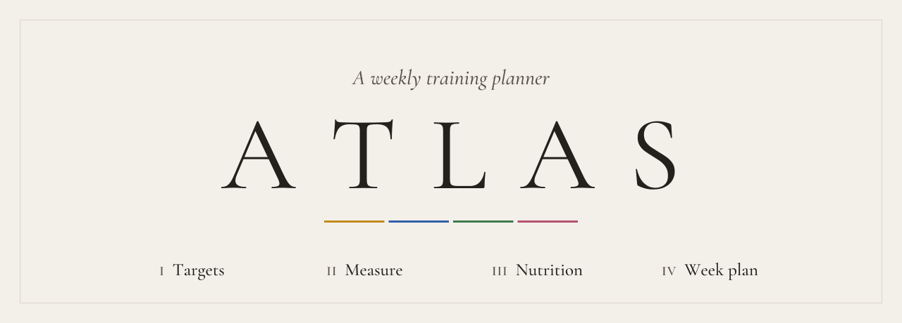

<picture>
  <source media="(prefers-color-scheme: dark)" srcset=".github/atlas-plate-dark.svg">
  
</picture>

<br>

**Plan a week of training around the muscles you want to build, and the hours you actually have.**

ATLAS is a weekly training planner built around a single sculpture. You choose muscles on a marble anatomical figure, give your measure, see what to eat for that training, and ATLAS places the sessions, exercises and meals into the free hours of your week.

The body never leaves the screen. Moving to another stage moves the camera around it, and the interface settles beside it: motion happens between stages, and within a stage everything stays still while you work.

It runs entirely in your browser. There is no account, no server and no build step: open `index.html` and it works. Nothing you enter leaves your machine.

> [!NOTE]
> ATLAS is a work in progress, built in the open. Targets and Measure have their new design; Nutrition and the Week plan still wear the old one. See [the roadmap](#roadmap).

<br>

## The four stages

Each new visit opens on the sculpture in one of five ways: the figure from below, the chest rising from the bottom edge, the name carved out of the ground with the camera diving through the T, the back of the shoulder up close, or the whole figure standing before the five letters. You see each one once before any repeats. A reload skips the opening and returns you to where you were.

| | Stage | What you do there | State |
|:-:|---|---|---|
| **I** | Targets | Pick muscles on the sculpture, then set each to Focus, Normal or Maintain. | Redesigned. The maths isn't evidenced yet. |
| **II** | Measure | Give your stature, mass, years and physiology, sealed into one plate. | Designed. Nothing reads its data yet. |
| **III** | Nutrition | Get calorie and protein targets worked out from the training. | Works, in the old design. |
| **IV** | Week plan | Get sessions, exercises and meals placed in your free hours. | Works, in the old design. |

### I · Targets

Targets has three movements, each with its own framing of the sculpture.

- **How it works.** The figure steps aside and acts out each stage as its chapter plays.
- **Your muscles.** Start from a program (whole-body splits, Push · Pull · Legs, or classic pairings), then refine it on the body. Pointing at a program previews its muscles on the sculpture. Click or tap any of the 16 muscle groups to add or remove it. Front and Back turn the body round, and a sideways drag turns it a little either way.
- **Training focus.** Your selection, grouped by family, each muscle with the weekly sets it starts from. Set a muscle to Focus for more sets and days, or Maintain for the minimum, which is trimmed first when the week is short. Resting on a row lights that muscle and turns the body to show it.

On the start screen, Targets and Measure, the light on the sculpture follows your pointer like a lamp held up to marble. Pointing at a muscle draws fine engraved traces across its whole training group, in the sculpture's own material, with a serif label beside the body. This is the **anatomical cartography** ([`docs/cartography.md`](docs/cartography.md)). The traces follow the painted borders and never invent anatomy.

### II · Measure

Measure is one scrolled page, with an instrument for each fact. A stadiometer beside the figure, numbered in your own height. A steelyard whose poise slides along the beam. A frieze of decades for the years you've lived. Then a choice of physiology for the resting-burn equation. Once all four are given, they're struck into a **seal**: a beaded coin with each fact inscribed around it in Roman numerals, laid out like a catalogue plate.

Measure doesn't affect the plan yet. Wiring it into training and nutrition is next on the roadmap.

### III · Nutrition *(optional)*

- **Goal:** fat loss, muscle gain, maintenance or general fitness, each showing what it would change for this training.
- **Targets:** calories set against your daily burn, and protein per kilogram of body weight, both adjusted to the plan's training load. Each figure shows the sum behind it, and every reason is one click away.
- **Rhythm:** meals a day, your eating window, and a diet style (everything, pescatarian, vegetarian or vegan).
- **A day of eating:** the day as a timeline, one meal open at a time, with an example plate portioned to it.

### IV · Week plan

- **Fit it into your life.** See the seven days the planner would place before you generate anything, with notes on what fits and what won't.
- **Shape your week.** Drag down a full-width calendar to mark the hours you're busy (or start from Weekdays 9–5), take days off, and set session length, preferred time and experience.
- **Your week.** Muscles are grouped into sessions with recovery tracked per muscle. Exercises are chosen from tiered ratings. Meals are placed around the workouts: busy hours block training but not meals, so a working day keeps its lunch. Point at a session to light its muscles on the sculpture, or open it to move it or to swap, add and remove exercises.

Your inputs are saved in the browser. Edits to a generated week aren't kept yet: a reload rebuilds the week from the same inputs.

<br>

## What ATLAS holds to

- **Every number is an estimate, and it says so.** Each calorie, protein and progress figure shows how it was worked out. ATLAS never promises a physique by a date.
- **Evidence is kept apart from decisions.** [`js/evidence.js`](js/evidence.js) records what the research says and how sure it is. Each planner value is labelled *evidence*, *heuristic*, *preference*, *optimization* or *safety*. A value may be called evidence only when a source supports that exact number, and today none is.
- **Anatomy comes first.** Every clickable area selects the muscle actually under it. Bone, tendon, the kneecap and the point of the elbow select nothing.
- **Four pigments for four families.** Push is yellow ochre, Pull Egyptian blue, Legs green earth and Core madder rose. These are the four colours under the name above.

<br>

## Run it

```sh
git clone https://github.com/ItsTreh/Atlas.git
cd Atlas
open index.html        # or double-click it
```

That's all: it opens straight from disk, with no build step and no server. Light and dark themes are built in (top-right toggle). The titles use Cormorant Garamond, which ships with the page, so ATLAS looks the same offline. A Content-Security-Policy in `index.html` lets the page load only its own files.

It's designed for desktop first. The phone layout works but is due its own redesign.

| URL | Opens |
|---|---|
| `index.html?start=off` | Skips the opening |
| `index.html?start=carved` | A chosen opening: `cinematic`, `torso`, `carved`, `detail` or `monument` |
| `index.html?anatomy=procedural` | The procedural figure that came before the sculpture |

### Tests

```sh
npm install
npm test
```

The [Vitest](https://vitest.dev) suites run the app's own files unchanged, loading them in Node in the same order and shared scope the browser uses. They cover the muscles, programs, evidence, estimates, nutrition, exercise selection and scheduling. They also check the sculpture's data and regions, the cartography, saving and restoring, and that no two scripts declare the same global.

<br>

## How it's built

The app is plain HTML, CSS and JavaScript, loaded as classic scripts in dependency order, with no framework, bundler or modules. That's why it opens from `file://`. The data stays apart from the UI: views read and write one shared state (`routine`, and `routine.selection` for the targets), and nothing keeps its own copy.

### The sculpture

```
assets/anatomy/Male_Body.blend         sculpted, and painted by hand in Blender: one colour per muscle
  + Male_Body.paint.png / .paint.json  the paint, and which colour names which region
  ▼  tools/anatomy/authored/male_body.py   cuts the mesh along the painted borders
assets/anatomy/male-body.glb           one primitive per region
  ▼  tools/anatomy/build-authored.mjs
js/anatomy-model-male-body.js          what the page loads
  ▼  js/anatomy-regions.js             region → one of the 16 muscle groups, or nothing
```

Every training muscle is painted, so the sculpture selects all 16 groups. Some painted muscles that no program trains, such as those of the shin, are drawn but not selectable. The renderer is WebGL2 with a matte marble material. Without WebGL2, an SVG figure takes over. If the sculpture's file is missing, the procedural figure (`npm run build:anatomy`) stands in. A rigged copy, `Male_Body_rigged.blend` (59 bones), is being prepared for posing, and the app doesn't use it yet ([`docs/male-body-rig.md`](docs/male-body-rig.md)).

### Files

```
index.html               one screen: the sculpture, with the four stages over it
css/styles.css           the theme: tokens, light and dark, the shell, every stage
fonts/                   Cormorant Garamond, under the SIL Open Font License (OFL.txt)

js/                      ── data and logic: no page code, all tested ──
  model.js               the 16 muscles, time slots, training blocks
  selection.js           MuscleSelection, the one source of truth for targets
  programs.js            the preset programs
  evidence.js            findings with sources, and every planner value with its origin
  estimate.js            weekly sets and time, and fitting targets to the time
  exercises.js           the exercise catalogue and its tier ratings
  workouts.js            each session's exercises
  distribution.js        spreads each muscle's weekly sets over the training days
  routine.js             WeeklyRoutine, the shared plan; places the week and its meals
  scheduler.js           finds the days and hours for the sessions
  nutrition.js, foods.js calorie and protein targets; foods, diets, example meals
  measure.js             the measure's four facts and the seal
  storage.js             saves your inputs in the browser, and restores them

                         ── the figure ──
  anatomy-load.js        loads the sculpture, unless ?anatomy=procedural
  anatomy-model*.js      the procedural figure and the sculpture (generated)
  anatomy-regions.js     region → app muscle
  anatomy-sculpture.js   the WebGL2 renderer, its camera shots and the lamp
  anatomy-cartography.js the surface samples the traces flow along
  anatomy.js             the SVG fallback
  anatomy-stage.js       the room the body stands in, between the page and a renderer

                         ── the page ──
  boot.js                shows the plain page if a script fails before start
  stages.js              moving between stages: out, moving, idle
  start.js               the five openings
  targets.js             Targets' three movements
  targets-muscles.js, targets-train.js
                         Your muscles and Training focus as scrolled pages, on a wide screen
  flow-front.js          the words behind the body, woven in front of the nearer leg
  measure-view.js        Measure: the instruments and the seal
  nutrition-view.js      Nutrition
  week-view.js, workout-view.js, paint.js
                         the Week plan, a session in full, painting busy hours
  render.js, app.js      shared helpers; wiring and boot

assets/anatomy/          the sculpture, its paint and its export (all rights reserved)
tools/anatomy/           the Blender export and the builds that turn it into scripts
tests/                   Vitest suites; load-app.js runs the real scripts in Node
docs/                    design notes: the redesign, the cartography, anatomy levels, the rig
CLAUDE.md, .claude/      working notes and agents for building ATLAS with Claude Code
```

<br>

## Where it's heading

The four stages are the path for a new user. Once you've been through them, your plan will live in **My Atlas**, where you adjust it instead of starting over. A recovery section will live there too, alongside ideas still being settled.

ATLAS is a website first, with no backend yet. A backend comes next, and a native app after that.

## Roadmap

**Done**
- [x] The theme: calm, monochrome, gallery-like, with light and dark modes and the serif
- [x] Male_Body, a sculpted 3D body painted muscle by muscle, selecting all 16 groups
- [x] One sculpture across every stage, with the camera moving between named shots
- [x] Front and Back, with a limited drag orbit, and a lamp that follows the pointer
- [x] The start screen and its five openings
- [x] Targets in three movements: How it works, Your muscles, Training focus
- [x] Measure, with its instruments and the seal
- [x] An evidence register that labels where every planner value comes from
- [x] AGPL licensing, a local font, and a Content-Security-Policy

**Now**
- [ ] Polish the anatomical cartography's hover and selection states
- [ ] Polish the painted borders, one muscle at a time

**Next**
1. Improve and evidence the maths on Targets.
2. Make Measure's data affect the training algorithm.
3. Redesign Nutrition, then evidence its maths the same way as Targets.
4. Evidence and redesign the Week plan.
5. Redesign the full phone layout.
6. Add a backend, then My Atlas for returning users, with saved data.
7. Make it an app.
8. Add a fitness news section.

**For the anatomy** ([`docs/anatomy-levels.md`](docs/anatomy-levels.md))
- A side view and zoom, added to the same camera.
- Three levels: the 16 training groups; the individual muscles, revealed by zooming in, each with a card on what it does and what trains it; and an exercise view that lights everything an exercise works.
- Finer regions under the groups, such as the three heads of the deltoid.
- Later, a weekly coverage map of the body.

**An idea, not a commitment**
- Optional sharing of progress: globally, locally or with friends.

<br>

## License

© 2026 Tred ([github.com/ItsTreh](https://github.com/ItsTreh)).

The code is licensed under the [GNU Affero General Public License v3.0 or later](LICENSE). If you run a modified version for others, including as a website, you must offer them its source.

The Male_Body sculpture is **not** under the AGPL: it is all rights reserved. That covers its `.blend` files (including the rigged one), the paint image and its colour key, the `.glb`, the manifest and `js/anatomy-model-male-body.js`; [ASSETS-LICENSE.md](ASSETS-LICENSE.md) lists them. Without the sculpture, ATLAS falls back to the procedural figure, which is AGPL like the rest of the code.

Cormorant Garamond is © the Cormorant Project Authors, under the [SIL Open Font License 1.1](fonts/cormorant-garamond/OFL.txt).
